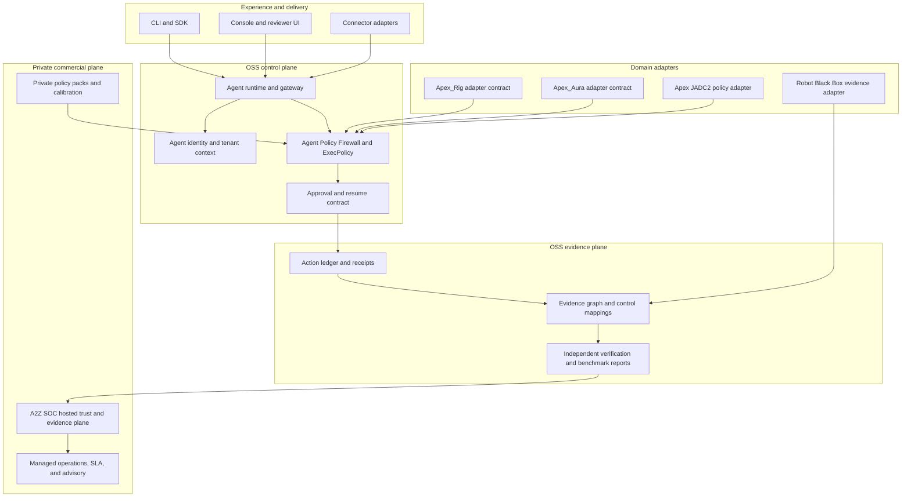

# GRC_Claw modular architecture and commercial boundary

This document defines how GRC_Claw is packaged as an inspectable OSS control and evidence plane, how external agent systems connect to it, and where the commercial A2Z SOC layer begins.

The goal is not to turn the repository into a monolith or to claim that an adapter is a production integration before it has been exercised. Every boundary below is designed to be testable with fixtures, receipts, and reproducible end-to-end runs.

## 1. Macro architecture



The planes have different responsibilities:

| Plane | OSS responsibility | Boundary condition |
| --- | --- | --- |
| Experience | CLI, SDK, console, and connector entry points | Must not bypass the policy boundary |
| Control | Identity, tenant context, tool policy, approvals, runtime dispatch | A non-`allowed` decision cannot reach execution |
| Evidence | Receipts, ledger, evidence graph, verification, benchmark reports | Claims are grounded in observed artifacts |
| Domain adapters | Translate a domain's authority and evidence vocabulary into stable contracts | Adapters do not silently invent domain semantics |
| Commercial | Hosted custody, private calibration, operations, support, and buyer workflows | No proprietary A2Z SOC implementation is required by the OSS core |

## 2. Packaging model

The repository remains an npm workspace monorepo. Packages are grouped by contract, not by customer or vendor:

```text
packages/
  core/                         value objects and shared types
  agent-identity/               actor and tenant identity
  agent-policy-firewall/        fail-closed policy boundary
  agent-runtime/                orchestration and execution lifecycle
  gateway/                      transport, auth, and idempotency
  evidence/                     receipts, action ledger, assurance envelopes
  evidence-graph/               canonical evidence objects and hashes
  frameworks/                   controls and crosswalks
  benchmark-intelligence/      reproducible evaluation reports
  browser-evidence/             browser evidence collection
  connectors/                   provider-neutral connector contracts
  cjadc2-operations/            policy and assurance reference domain
  physical-ai-assurance/        physical-AI assurance contracts
  robot-black-box-*             evidence, custody, and review contracts
```

Each publishable package must provide:

1. A narrow public entry point through `exports`.
2. A `files` allowlist containing built output only.
3. No import from a private commercial package.
4. A package-level build and test command.
5. A README that states implemented behavior, limitations, and evidence produced.
6. A fixture or example that can be replayed without customer data or network access.

The root workspace may compose packages for demos, but a package must remain usable without the demo application. This keeps the OSS core independently auditable and prevents accidental coupling between the public engine and A2Z SOC operations.

## 3. Stable integration contract

External systems connect through four versioned contracts:

```ts
type IntegrationRequest = {
  schema: "grc-claw.integration-request/v1";
  systemId: string;
  tenantId: string;
  actorId: string;
  action: string;
  inputDigest: string;
  policyVersion: string;
  evidenceRefs: string[];
};

type PolicyDecision = {
  outcome: "allowed" | "denied" | "needs_approval";
  reason: string;
  requiresApproval: boolean;
  decisionDigest: string;
};

type ExecutionReceipt = {
  schema: "grc-claw.execution-receipt/v1";
  requestDigest: string;
  decisionDigest: string;
  executionState: "not_started" | "started" | "completed" | "failed";
  resultDigest?: string;
  receiptHash: string;
};

type VerificationReport = {
  schema: "grc-claw.verification-report/v1";
  sourceRefs: string[];
  checks: Array<{ id: string; status: "pass" | "fail" | "unknown" | "not_applicable" }>;
  limitations: string[];
};
```

An adapter may add domain fields, but it must preserve the base contract. Unknown domain behavior is represented as `unknown` or `not_applicable`, never as an inferred pass.

## 4. Apex_Rig and Apex_Aura boundary

The names Apex_Rig and Apex_Aura are treated as external domain systems in this repository. No source, API, or public repository for either system is assumed here. Their adapters therefore begin as contract packages and fixtures, not as claims of integration.

### Apex_Rig adapter contract

The intended boundary is a rig or infrastructure execution system that submits a proposed action and receives a policy decision. The adapter must expose:

- actor, tenant, system, and environment identity;
- action and input digests;
- requested capability and blast-radius metadata;
- approval requirement and expiry;
- execution result and evidence references.

The adapter must never execute an action directly from an LLM response. It calls the GRC_Claw policy boundary and only forwards an `allowed` decision with a valid receipt context.

### Apex_Aura adapter contract

The intended boundary is an agent or orchestration system that proposes plans, delegates work, or synthesizes decisions. The adapter must expose:

- plan identity and parent-child delegation;
- model/provider metadata when available;
- tool or capability requests;
- policy version and evaluation inputs;
- approval, resume, cancellation, and expiry transitions;
- final result and cited evidence.

The adapter is not a replacement orchestrator. It makes the orchestration observable, policy-constrained, and reviewable.

Both adapters must begin with fixture-backed conformance tests. A production connector is only claimed after a real integration run records the source version, observed payloads, verification results, and limitations.

## 5. Positioning relative to IBM watsonx Orchestrate

IBM watsonx Orchestrate is an enterprise automation and agent-orchestration product. GRC_Claw should not position itself as a feature-for-feature replacement. The complementary wedge is the assurance layer that makes heterogeneous orchestration acceptable to security, audit, procurement, and regulated buyers.

| Concern | Orchestration product | GRC_Claw and A2Z SOC wedge |
| --- | --- | --- |
| Plan and task execution | Agent skills, workflows, and enterprise actions | Observes and constrains proposed actions through policy contracts |
| Authority | Product and connector permissions | Explicit actor, tenant, tool, approval, expiry, and separation-of-duties evidence |
| Evidence | Product execution history | Portable receipts, hash-linked ledger, evidence graph, and independent verification |
| Cross-framework assurance | Usually an integration or governance activity | Framework mappings and buyer-ready proof packets are first-class OSS contracts |
| Deployment model | Vendor platform | Local OSS verifier, self-hosted deployments, or A2Z SOC hosted operations |
| Commercial wedge | Platform seats and automation adoption | Private calibration, managed custody, policy packs, evidence operations, and assurance services |

This is a positioning distinction, not a claim that GRC_Claw currently has feature parity with IBM. Any comparison used in marketing must cite the tested capability, version, fixture, and limitation.

## 6. Commercial layer

The commercial layer begins where recurring operational responsibility, private calibration, or hosted custody begins. It is not created by hiding the OSS policy primitive.

### Public OSS layer

- policy and evidence contracts;
- local verifier and replayable fixtures;
- framework crosswalk interfaces;
- adapter SDK and conformance tests;
- benchmark runner and report schema;
- reference integrations with explicit limitations.

### Private A2Z SOC layer

- hosted multi-tenant evidence storage and retention;
- managed identity, key custody, and tenant operations;
- private policy packs and customer-specific calibration;
- connector maintenance and evidence freshness monitoring;
- auditor, procurement, and board reporting workflows;
- implementation, incident support, SLA, and managed assurance.

The commercial wedge is measured by outcomes that buyers can verify:

| KPI | Definition | Evidence |
| --- | --- | --- |
| Time to first verified packet | Intake to independently verifiable evidence packet | Timestamped run and report |
| Evidence freshness | Median age of required evidence by control | Connector receipts and freshness report |
| Unsafe execution prevention | Non-`allowed` actions reaching execution | Adapter boundary counter, target zero |
| Approval integrity | Approvals bound to actor, receipt, expiry, and policy version | Approval verification report |
| Rework avoided | Rejected or incomplete evidence detected before audit review | Issue and evidence lineage |
| Integration reliability | Successful verified runs divided by attempted runs | Run ledger and failure taxonomy |
| Gross service margin | Revenue less hosting, connector, support, and custody costs | Internal cost ledger |

No KPI should be reported without its denominator, observation window, source artifacts, and known limitations.

## 7. End-to-end conformance path

Every adapter and commercial claim should follow the same path:

```text
fixture or observed input
  -> identity and tenant context
  -> policy evaluation
  -> approval or denial state
  -> adapter execution boundary
  -> receipt and ledger append
  -> evidence-graph projection
  -> independent verification
  -> benchmark report
  -> optional A2Z SOC hosted workflow
```

The benchmark is green only when the observed artifacts support the result. A missing connector, unavailable provider, or unverified custody path must be reported as `unknown` or `not_applicable`.

## 8. Evolution path

1. **Core contract:** stabilize policy, receipt, ledger, evidence, and report schemas.
2. **Adapter conformance:** add Apex_Rig, Apex_Aura, Apex JADC2, and Robot Black Box fixtures without importing private implementations.
3. **Integration evidence:** run against real systems only where access and authorization exist, retaining payload digests and limitations.
4. **Commercial calibration:** move customer-specific policy packs, hosted custody, connector operations, and SLA workflows to A2Z SOC.
5. **Independent evaluation:** publish reproducible benchmark reports before making cross-system or competitive claims.

This structure lets GRC_Claw remain a credible OSS control and evidence substrate while A2Z SOC compounds the operational, calibration, and distribution advantages that cannot be obtained from a package install alone.
