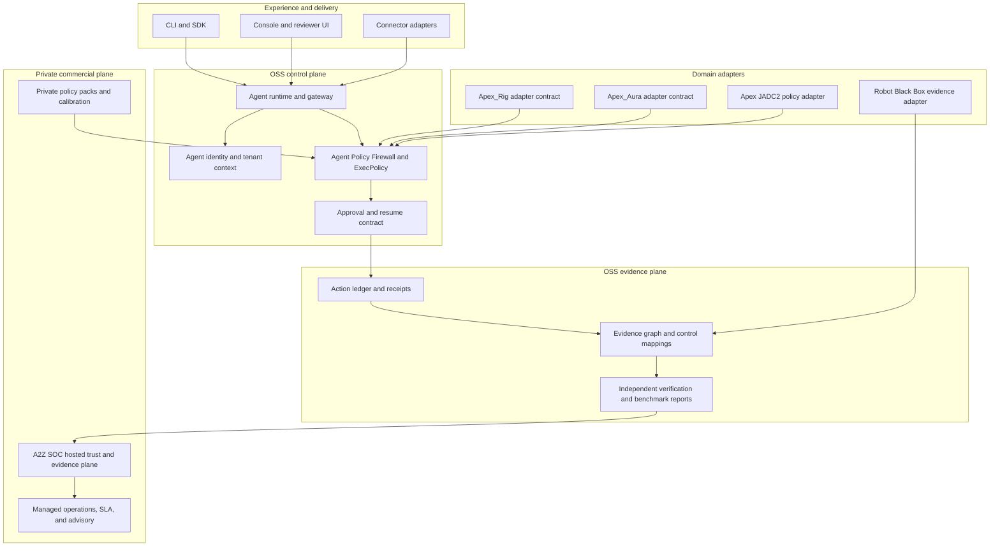

# GRC_Claw modular architecture and commercial boundary

This document defines how GRC_Claw is packaged as an inspectable OSS control and evidence plane, how external agent systems connect to it, and where the commercial A2Z SOC layer begins.

The goal is not to turn the repository into a monolith or to claim that an adapter is a production integration before it has been exercised. Every boundary below is designed to be testable with fixtures, receipts, and reproducible end-to-end runs.

## Navigation and implementation map

This proposal is anchored to the repository's existing implementation, not to an abstract platform diagram.

| Layer in this document | Current repository entry point | What to inspect |
| --- | --- | --- |
| Shared value objects | [`packages/core`](../packages/core/) | Common IDs, types, and domain primitives |
| Identity and tenant context | [`packages/agent-identity`](../packages/agent-identity/) and [`packages/rbac-multi-tenant`](../packages/rbac-multi-tenant/) | Actor, tenant, and authorization boundaries |
| Policy boundary | [`packages/agent-policy-firewall`](../packages/agent-policy-firewall/) | Fail-closed decisions, approval state, tool boundary, receipts |
| Runtime and transport | [`packages/agent-runtime`](../packages/agent-runtime/), [`packages/gateway`](../packages/gateway/) | Dispatch, gateway, idempotency, and lifecycle behavior |
| Evidence and hashes | [`packages/evidence`](../packages/evidence/) and [`packages/evidence-graph`](../packages/evidence-graph/) | Action ledger, canonical objects, evidence projection, verification |
| Framework semantics | [`packages/frameworks`](../packages/frameworks/) and [`packages/framework-crosswalk`](../packages/framework-crosswalk/) | Control vocabulary and cross-framework mapping |
| Benchmarks | [`packages/benchmark-intelligence`](../packages/benchmark-intelligence/) and [Issue #22](https://github.com/AAH20/GRC_Claw/issues/22) | Fixture, gate, replay, mutation, and report contracts |
| Domain assurance | [`packages/cjadc2-operations`](../packages/cjadc2-operations/), [`packages/physical-ai-assurance`](../packages/physical-ai-assurance/), [`packages/military-robot-firewall`](../packages/military-robot-firewall/) | Existing policy and assurance reference domains |
| Public architecture | [`ARCHITECTURE.md`](../ARCHITECTURE.md), [`CLAIMS_AND_LIMITATIONS.md`](../CLAIMS_AND_LIMITATIONS.md) | Current planes, boundaries, and claim discipline |

Related external repositories and surfaces:

- [Apex JADC2](https://github.com/AAH20/Apex_JADC2) is the decision-policy reference surface for F2T2EA, rules of engagement, authorization, deconfliction, coalition federation, and sovereign or air-gapped operation.
- [Robot Black Box](https://github.com/AAH20/robot-black-box) is the evidence and verification reference surface for authority, execution, outcome, provenance, offline verification, and explicit unknown states.
- [Apex Rig](https://github.com/AAH20/apex-rig) is the sovereign multi-harness aggregator and hardware-aware cognitive router. Its README describes harness supervision, entropy-based routing, dynamic VRAM/KV-cache projection, provider bridges, and a zero-dependency Python core.
- [Apex Aura](https://github.com/AAH20/apex-aura) is the sovereign cognitive fabric and AI hypervisor reference. Its README describes a layered ingress, perception, routing, inference, execution, governance, and data subsystem, with NVIDIA NIM, IBM Granite, OpenShift, and 6G-related integration points.
- [GRC_Claw PR #21](https://github.com/AAH20/GRC_Claw/pull/21) is the deterministic package-test discovery and failure-accounting baseline.
- [GRC_Claw Issue #22](https://github.com/AAH20/GRC_Claw/issues/22) defines the approval, replay, policy, receipt-integrity, and report-schema benchmark direction.
- [A2Z SOC](https://a2zsoc.com) is the hosted commercial plane. Its public entry points include the [trust center](https://a2zsoc.com/trust-center), [AI assurance passport](https://a2zsoc.com/ai-assurance-passport), and [international partner desk](https://a2zsoc.com/international-partners).

For the competitive boundary, the relevant IBM references are [watsonx Orchestrate agent orchestration](https://www.ibm.com/docs/en/watsonx/watson-orchestrate/base?topic=agents-adding-orchestration), [agent lifecycle guidance](https://www.ibm.com/docs/en/watsonx/watson-orchestrate/base?topic=agents-getting-started-building), and [workflow builder documentation](https://www.ibm.com/docs/en/watsonx/watson-orchestrate/base?topic=workflows-creating-agentic-in-workflow-builder). These links are used to define a precise complement, not to claim parity.

### Reproduce the core path

From the repository root:

```bash
npm install
npm run build
npm run test:firewall
npm run test:benchmark
```

The commands above exercise the local OSS build and package-level policy and benchmark surfaces. A domain adapter is not considered integrated merely because its types compile. It must add fixture cases, observed payloads, receipt verification, and a report that records limitations.

## 1. Macro architecture



The planes have different responsibilities:

| Plane | OSS responsibility | Boundary condition |
| --- | --- | --- |
| Experience | CLI, SDK, console, and connector entry points | Must not bypass the policy boundary |
| Control | Identity, tenant context, tool policy, approvals, runtime dispatch | A non-`allowed` decision cannot reach execution |
| Evidence | Receipts, ledger, evidence graph, verification, benchmark reports | Claims are grounded in observed artifacts |
| Domain adapters | Translate a domain's authority and evidence vocabulary into stable contracts | Adapters do not silently invent domain semantics |
| Commercial | Hosted custody, private calibration, operations, support, and buyer workflows | No proprietary A2Z SOC implementation is required by the OSS core |

## 2. Packaging model

The repository remains an npm workspace monorepo. Packages are grouped by contract, not by customer or vendor:

```text
packages/
  core/                         value objects and shared types
  agent-identity/               actor and tenant identity
  agent-policy-firewall/        fail-closed policy boundary
  agent-runtime/                orchestration and execution lifecycle
  gateway/                      transport, auth, and idempotency
  evidence/                     receipts, action ledger, assurance envelopes
  evidence-graph/               canonical evidence objects and hashes
  frameworks/                   controls and crosswalks
  benchmark-intelligence/      report aggregation and benchmark analysis
  browser-evidence/             browser evidence collection
  connectors/                   provider-neutral connector contracts
  cjadc2-operations/            policy and assurance reference domain
  physical-ai-assurance/        physical-AI assurance contracts
  robot-black-box-*             evidence, custody, and review contracts
```

Each publishable package must provide:

1. A narrow public entry point through `exports`.
2. A `files` allowlist containing built output only.
3. No import from a private commercial package.
4. A package-level build and test command.
5. A README that states implemented behavior, limitations, and evidence produced.
6. A fixture or example that can be replayed without customer data or network access.

The root workspace may compose packages for demos, but a package must remain usable without the demo application. This keeps the OSS core independently auditable and prevents accidental coupling between the public engine and A2Z SOC operations.

### Benchmark placement

Benchmark v0 is intentionally split by responsibility:

```text
benchmarks/runner/              executable deterministic harness
benchmarks/fixtures/            versioned offline input cases
benchmarks/reports/             local generated output, ignored by Git
schemas/grc-claw-benchmark-report-v1.schema.json
                                versioned report contract
packages/benchmark-intelligence/
                                report aggregation and analysis APIs
```

The runner stays beside the fixtures because it is an executable repository-level conformance harness. `@grc-claw/benchmark-intelligence` remains a reusable package that consumes validated reports for aggregation, trend analysis, and opt-in anonymized outcome intelligence. It does not own fixture execution or silently turn unverified inputs into benchmark claims.

## 3. Stable integration contract

External systems connect through four versioned contracts:

```ts
type IntegrationRequest = {
  schema: "grc-claw.integration-request/v1";
  systemId: string;
  tenantId: string;
  actorId: string;
  action: string;
  inputDigest: string;
  policyVersion: string;
  evidenceRefs: string[];
};

type PolicyDecision = {
  outcome: "allowed" | "denied" | "needs_approval";
  reason: string;
  requiresApproval: boolean;
  decisionDigest: string;
};

type ExecutionReceipt = {
  schema: "grc-claw.execution-receipt/v1";
  requestDigest: string;
  decisionDigest: string;
  executionState: "not_started" | "started" | "completed" | "failed";
  resultDigest?: string;
  receiptHash: string;
};

type VerificationReport = {
  schema: "grc-claw.verification-report/v1";
  sourceRefs: string[];
  checks: Array<{ id: string; status: "pass" | "fail" | "unknown" | "not_applicable" }>;
  limitations: string[];
};
```

An adapter may add domain fields, but it must preserve the base contract. Unknown domain behavior is represented as `unknown` or `not_applicable`, never as an inferred pass.

## 4. Apex Rig and Apex Aura integration boundary

These are real public projects with distinct responsibilities, so the boundary is explicit rather than generic.

### Apex Rig: harness and routing plane

The [Apex Rig repository](https://github.com/AAH20/apex-rig) describes a sovereign multi-harness aggregator, hardware-aware cognitive router, and agent mesh. The repository documents a Python core, harness supervision, prefix deduplication, entropy routing, provider bridges, dynamic memory projection, and workspace journaling.

GRC_Claw should integrate at the proposed-action boundary:

| Apex Rig signal | GRC_Claw contract |
| --- | --- |
| Harness, workspace, and operator identity | `IntegrationRequest.actorId`, `tenantId`, and `systemId` |
| Selected harness, provider, model, and routing rationale | Evidence metadata and policy evaluation context |
| Prompt or task input | Redacted input digest and provenance reference |
| Tool, file, or subprocess proposal | Policy evaluation and capability request |
| Workspace journal mutation | Approval-required or denied decision before commit |
| Result, rollback, or failure | Execution receipt, ledger entry, and evidence reference |

The adapter must not treat a router selection as authorization. Apex Rig chooses how work may be carried out; GRC_Claw decides whether the requested capability is permitted and records the evidence needed to review that decision.

### Apex Aura: sovereign execution and infrastructure plane

The [Apex Aura repository](https://github.com/AAH20/apex-aura) describes a sovereign cognitive fabric and AI hypervisor with layered ingress, perception, routing, inference, execution, governance, and data subsystems. Its documented integration vocabulary includes NVIDIA NIM, IBM Granite, OpenShift, BlueField and DOCA, 6G or O-RAN, computer-use perception, action contracts, rollback journals, and audit-ledger components.

GRC_Claw should integrate at the control and evidence seams:

| Apex Aura signal | GRC_Claw contract |
| --- | --- |
| Ingress packet and system identity | Versioned integration request and tenant context |
| Decision-router output | Policy decision with outcome, reason, and policy version |
| Precondition and postcondition checks | Evidence references and execution-state transitions |
| Saga or rollback event | Receipt, ledger ordering, and compensating-action evidence |
| Model, NIM, Granite, GPU, DPU, or edge metadata | Environment metadata in the verification report |
| Governance or audit event | Canonical evidence object and independent verification |

GRC_Claw does not replace Apex Aura's inference, hardware, or execution components. It supplies the cross-system policy, approval, receipt, evidence, and verification contracts that make those components reviewable by security, audit, procurement, and regulated buyers.

The empirical benchmark numbers documented in either project remain project-local claims until a reproducible fixture, environment capture, and independent run are attached to a GRC_Claw benchmark report. The adapter must preserve the distinction between a repository-reported result and a result verified by this project.

### Combined composition

```text
Apex Rig harness and router
  -> Apex Aura execution and infrastructure fabric
  -> GRC_Claw policy, approval, receipt, ledger, and evidence graph
  -> A2Z SOC hosted custody, calibration, and buyer workflow
```

This composition gives each project a clear role instead of collapsing the stack into one opaque agent runtime.

## 5. Positioning relative to IBM watsonx Orchestrate

IBM watsonx Orchestrate is an enterprise automation and agent-orchestration product. GRC_Claw should not position itself as a feature-for-feature replacement. The complementary wedge is the assurance layer that makes heterogeneous orchestration acceptable to security, audit, procurement, and regulated buyers.

| Concern | Orchestration product | GRC_Claw and A2Z SOC wedge |
| --- | --- | --- |
| Plan and task execution | Agent skills, workflows, and enterprise actions | Observes and constrains proposed actions through policy contracts |
| Harness and model routing | [Apex Rig](https://github.com/AAH20/apex-rig) focuses on multi-harness supervision, routing, and hardware-aware selection | GRC_Claw records the routing context and evaluates the requested capability |
| Sovereign execution fabric | [Apex Aura](https://github.com/AAH20/apex-aura) documents ingress, perception, inference, execution, governance, and infrastructure layers | GRC_Claw supplies approval, receipt, evidence, and independent verification seams |
| Authority | Product and connector permissions | Explicit actor, tenant, tool, approval, expiry, and separation-of-duties evidence |
| Evidence | Product execution history | Portable receipts, hash-linked ledger, evidence graph, and independent verification |
| Cross-framework assurance | Usually an integration or governance activity | Framework mappings and buyer-ready proof packets are first-class OSS contracts |
| Deployment model | Vendor platform | Local OSS verifier, self-hosted deployments, or A2Z SOC hosted operations |
| Commercial wedge | Platform seats and automation adoption | Private calibration, managed custody, policy packs, evidence operations, and assurance services |

This is a positioning distinction, not a claim that GRC_Claw currently has feature parity with IBM. Any comparison used in marketing must cite the tested capability, version, fixture, and limitation.

## 6. Commercial layer

The commercial layer begins where recurring operational responsibility, private calibration, or hosted custody begins. It is not created by hiding the OSS policy primitive.

### Public OSS layer

- policy and evidence contracts;
- local verifier and replayable fixtures;
- framework crosswalk interfaces;
- adapter SDK and conformance tests;
- benchmark runner and report schema;
- reference integrations with explicit limitations.

### Private A2Z SOC layer

- hosted multi-tenant evidence storage and retention;
- managed identity, key custody, and tenant operations;
- private policy packs and customer-specific calibration;
- connector maintenance and evidence freshness monitoring;
- auditor, procurement, and board reporting workflows;
- implementation, incident support, SLA, and managed assurance.

The commercial wedge is measured by outcomes that buyers can verify:

| KPI | Definition | Evidence |
| --- | --- | --- |
| Time to first verified packet | Intake to independently verifiable evidence packet | Timestamped run and report |
| Evidence freshness | Median age of required evidence by control | Connector receipts and freshness report |
| Unsafe execution prevention | Non-`allowed` actions reaching execution | Adapter boundary counter, target zero |
| Approval integrity | Approvals bound to actor, receipt, expiry, and policy version | Approval verification report |
| Rework avoided | Rejected or incomplete evidence detected before audit review | Issue and evidence lineage |
| Integration reliability | Successful verified runs divided by attempted runs | Run ledger and failure taxonomy |
| Gross service margin | Revenue less hosting, connector, support, and custody costs | Internal cost ledger |

No KPI should be reported without its denominator, observation window, source artifacts, and known limitations.

## 7. End-to-end conformance path

Every adapter and commercial claim should follow the same path:

```text
fixture or observed input
  -> identity and tenant context
  -> policy evaluation
  -> approval or denial state
  -> adapter execution boundary
  -> receipt and ledger append
  -> evidence-graph projection
  -> independent verification
  -> benchmark report
  -> optional A2Z SOC hosted workflow
```

The benchmark is green only when the observed artifacts support the result. A missing connector, unavailable provider, or unverified custody path must be reported as `unknown` or `not_applicable`.

## 8. Evolution path

1. **Core contract:** stabilize policy, receipt, ledger, evidence, and report schemas.
2. **Adapter conformance:** add Apex_Rig, Apex_Aura, Apex JADC2, and Robot Black Box fixtures without importing private implementations.
3. **Integration evidence:** run against real systems only where access and authorization exist, retaining payload digests and limitations.
4. **Commercial calibration:** move customer-specific policy packs, hosted custody, connector operations, and SLA workflows to A2Z SOC.
5. **Independent evaluation:** publish reproducible benchmark reports before making cross-system or competitive claims.

This structure lets GRC_Claw remain a credible OSS control and evidence substrate while A2Z SOC compounds the operational, calibration, and distribution advantages that cannot be obtained from a package install alone.
